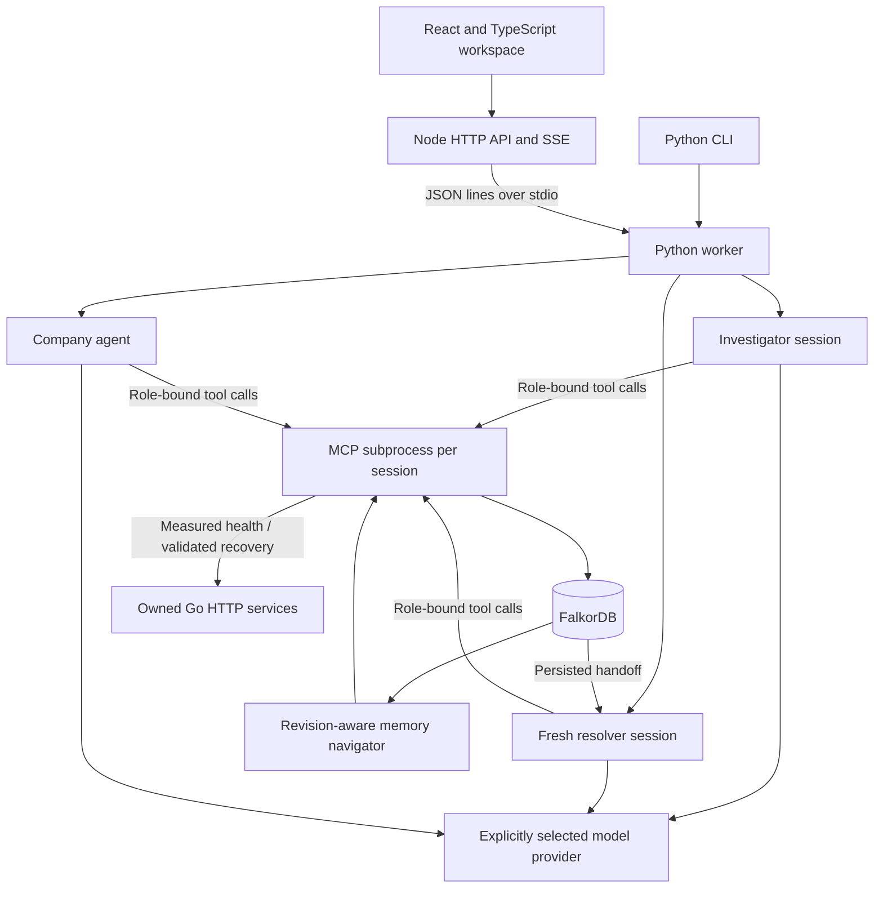

# How GraphOps works

Start with [MODULES.md](MODULES.md) for the product definition, folder map,
repository interfaces and one task through the six modules. This document
explains the runtime decisions in more depth. [LEARN.md](LEARN.md) provides a
hands-on walkthrough for participants.

## Graph is a decision dependency

The agent sees sourced dependency paths from Cypher together with live HTTP
measurements. A failed gateway can be a propagated symptom. The correct cause
must be directly failing and reachable in the graph. An unrelated failing
analytics service remains visible as a distractor.

Handoff and execution both recheck graph connectivity. Removing an essential
edge blocks action even if the model guesses the known service name. Without
FalkorDB, the app cannot retrieve context, create a handoff or validate a plan.
The SVG uses database edges; its four fixture node positions are a fixed layout.

## Model and deterministic responsibilities

The runtime first supplies a compact checkpoint and current observations.
By default, Run agent completes investigation and starts a fresh resolver after
the handoff is persisted. The optional Pause at handoff control stops before
recovery so a person can resume it later or demonstrate an app restart.
The model selects follow-up tools and a cause or blocker. A new resolver model
session selects plan preparation, execution and ticket completion. Agent loops
are bounded at eight model requests and 24 tool calls per session. Unfinished
work produces an interruption/checkpoint, rather than a successful result.

Tool argument schemas are checked before dispatch. Source content is labeled as
data. Roles restrict tools available through real stdio MCP sessions. The backend
validates endpoints, ownership of plan IDs, graph paths, procedure versions,
preconditions and live measurements before making an effect. These checks do
not rely on the model remembering an instruction.

Text alone cannot save a handoff or complete a recovery. A successful tool
transition produces a concise backend summary explicitly labeled with its
origin. Model prose remains labeled as model output; hidden reasoning is not
persisted or streamed. The separate scripted mode exercises the same tools
using a deterministic policy and is always identified as a baseline.

## Persisted coordination

Incident nodes carry versioned checkpoints. A compare-and-set Cypher update
allows one concurrent writer for a given version. Sessions and tool evidence are
append-only event nodes. Resolver sessions receive the incident, target and
evidence references from the graph, not a copied conversational summary.

Before an effect, the incident enters `executing` and records a stable operation
ID. The Go service saves the result under that ID, so an interrupted resolver
can replay the exact operation without duplicating the effect. The graph and
HTTP service are separate stores: this is an idempotent recovery protocol, not
a distributed transaction. Failure during graph updates after an effect still
requires a fresh checkpoint and measured verification.

## Memory navigator

| Kind | Meaning | Applicability |
|---|---|---|
| Episodic | Past measured recovery and evidence references | Always historical |
| Procedural | Successful operation, precondition and runbook revision | Active only if configuration and current procedure revision match |
| Semantic | Latest measured healthy fact | Same configuration; expires after 30 seconds |
| Unverified | A claim with no verified provenance | Separate labeled group |

Packets contain at most 12 recent records. Cache keys include graph name,
context revision, service and measured configuration. The cache holds at most
64 entries for up to ten seconds, shortened at the observation-expiry boundary.
Context writes invalidate previous revision keys. Reuse of a cache packet does
not authorize an action; the resolver reads current sources and remeasures.

Conflicting active claims are listed in the packet. Retrieval and tool guards
reduce unsupported action; they do not guarantee hallucination-free prose or
prove that memory improves success rate. An ablation is still needed to measure
the benefit of memory versus no memory.

## Company knowledge

Teams own services and connect to expertise. Services attach runbook, ticket,
decision and chat sources. Documents point to immutable Revision nodes. Current
document pointers may change, while previous revision payloads remain available.
Ownership and procedure edits are limited to the synthetic company graph.

Text/Markdown imports create versioned reference documents attached to services.
Optimistic revision checks prevent stale edits. Agents can search current source
text and read paged documents through MCP. Imported content cannot change the
approved action policy. A source citation must match a retrieved location before
a company answer finishes; claim entailment remains outside this validation.

Ticket completion is selected by the backend from the handoff target and only
allowed after measured recovery. This is a local versioned document update;
there is no Slack/Jira/GitHub integration or message sent to a real person.

## Serving and deployment

TypeScript owns HTTP, static files and streaming. A persistent Python process
handles requests over stdio, with model work offloaded to a thread so UI
snapshots remain available. The Go lab runs separate concurrent listeners for
gateway, orders, payments, analytics and a token-protected controller. It saves
operation state to a local file with a synchronized temporary-file replacement.

The local app binds to loopback. Network binding requires a shared demo token;
the browser stores access in an HttpOnly SameSite cookie. The VM template enables
Secure cookies behind Caddy HTTPS. Database and lab ports are private. A single
server-fixed graph scope prevents clients choosing another workspace, but this
is not per-user authorization. One agent job and at most 20 SSE viewers are
allowed. Node restarts a failed Python worker; incidents still require explicit
resume from their persisted checkpoints. System diagnostics distinguish model
availability from actual inference and MCP verification. Logical backups include
graph and controlled-service state, with restoration restricted to a new
workspace. Restored semantic health facts require new verification.

Production multi-user operation needs an identity and authorization design,
durable queues, operational metrics and production disaster-recovery exercises.

## Connected terminal and monitoring

The CLI connects to the same authenticated HTTP API as React by default. It does
not launch another worker or lab unless standalone mode is explicitly selected.
Task mutations are submitted once; the terminal then follows saved graph events
through a paginated insertion-order cursor. A watch can replay an old run, detach
and reconnect. A network timeout does not automatically resubmit an action.

The monitor combines module/job state, readiness and owned process measurements.
Node supplies its own PID/RSS/CPU time; Python samples its known worker and Go
process IDs on Windows/Linux. MCP checkpoints report a PID labeled as a past
observation, not a heartbeat. No process command lines or environments are read.
CPU seconds are accumulated process time. Graph/model availability and verified
inference remain distinct observations.

Process monitoring can report degraded state when the graph/worker is unavailable.
Company retrieval, connected decision checks, actions and shared memory still
require FalkorDB. See [CLI.md](CLI.md) for commands and output semantics.
