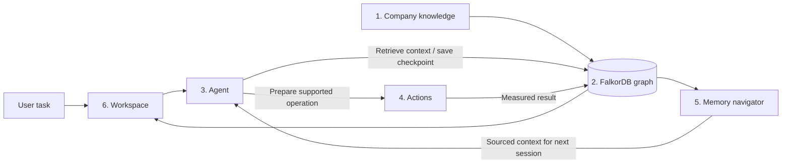

# GraphOps: six modules, one company copilot

## What are we building?

A company copilot with shared memory. A person gives it a task. The copilot finds
relevant company context in FalkorDB, chooses supported steps, verifies the
outcome, and preserves sourced knowledge for another session.

The first action adapter is a simulated checkout company. It gives us a visible,
repeatable example: find a failing dependency, recover it using a current
procedure, and verify checkout health. The company is synthetic; the HTTP
measurements, model requests, MCP calls and graph operations are real.

## The six product modules

| Module | Input | Output | Main implementation |
|---|---|---|---|
| 1. Company knowledge | Documents, service ownership, procedure updates, questions | Versioned sources and searchable company context | `graphops/company/`, `web/src/features/company/` |
| 2. Graph | Company entities, relationships, tasks and evidence | Connected context, dependency paths and durable state | `graphops/graph/` |
| 3. Agent | Task, current checkpoint, available tools and model | Tool selections, a handoff, a sourced answer or a blocker | `graphops/agents/`, `graphops/models/`, `web/src/features/agent/` |
| 4. Actions | Prepared plan, current procedure and live observations | Measured recovery or an explicit rejection | `graphops/actions/`, `lab/` |
| 5. Memory | Verified outcome or a retrieval request | Sourced episodes, procedures and facts with applicability labels | `graphops/memory/`, `web/src/features/memory/` |
| 6. Workspace | User commands and read requests | UI, CLI, task history, reports, diagnostics and backups | `graphops/runtime/`, `graphops/workspace/`, `graphops/runs/`, `web/api/`, `web/src/app/` |

These modules run in one application stack. A module is a code responsibility
with an interface; it does not need its own server or deployment.



## Repository map

```text
event/
  graphops/
    company/       Source imports, revisions, search and ownership edits
    graph/         FalkorDB connection, topology and repository composition
    agents/        Model loop, investigation, session context and MCP catalog
    actions/       Supported recovery policy, recovery tools and Go adapter
    memory/        Memory repository, retrieval rules and memory MCP tools
    workspace/     Read models, audit and complete backup/restore
    runs/          Task checkpoints, sessions, events and recovery plans
    models/        Explicit provider routing and inference transports
    runtime/       Worker lifecycle, job dispatch and CLI implementation
    core/          Identifiers and shared synthetic fixture definitions
    settings.py    Local configuration and data location
    cli.py         Stable CLI command entry point
    worker.py      Stable worker process entry point
    mcp_server.py  Stable MCP process entry point
  web/
    api/
      routes/      Company, run and workspace HTTP routes
      worker.ts    Python worker transport, supervision and progress streams
      access.ts    Shared access token and request-origin checks
      http.ts      JSON responses and bounded request parsing
      assets.ts    Static application files
      config.ts    Server configuration
    src/
      app/         Application shell, workspace state and navigation
      features/
        home/      Plain-English product explanation and module map
        company/   Company sources and questions
        graph/     Actual graph relationships and evidence inspection
        agent/     Controlled task execution
        memory/    Shared memory navigation
        runs/      History and event timeline
        system/    Readiness, verification and backups
      shared/      HTTP client, contracts, formatting and common UI
      main.tsx     Application mount only
    server.ts      Server composition only
  lab/             Concurrent Go service simulator
  tests/           Integration, UI, model and packaged acceptance checks
  deploy/          Docker/Caddy deployment configuration
```

## Module interfaces

`WorkspaceGraph` composes repositories over a single scoped FalkorDB connection:

```python
graph.company.context("payments")       # Current owners and source revisions
graph.company.search("refund")          # Search current source text
graph.topology.paths("gateway")         # Connected dependency paths
graph.runs.get(task_id)                  # Persisted checkpoint
graph.runs.append_event(task_id, session, role, kind, data)
graph.memory.list("payments")           # Sourced stored memory
graph.plans.get_or_create(task_id, data=validated_plan)
```

Each repository owns its Cypher queries. The graph connection owns transport and
context revision increments. `WorkspaceGraph` wires the repositories together.

The MCP catalog composes four capability objects bound to the same task/session:
investigation, company knowledge, memory and recovery. The role decides which
methods MCP exposes. Recovery tools also validate the role, graph path, current
runbook, plan ownership and live preconditions before an effect.

The TypeScript server handles access and dispatches module routes to the Python
worker. The worker owns one active job. Read models live in `workspace/queries.py`;
company mutations live in `company/service.py`. UI feature pages consume the
shared workspace controller, which owns polling, streamed progress and commands.

## One task through the modules

1. Workspace starts a controlled checkout failure and creates a graph task.
2. The investigator opens a fresh MCP session and reads the checkpoint.
3. Graph paths show `gateway -> orders -> payments`. Live HTTP checks identify
   a direct payments error. Analytics is failing outside that path.
4. The agent saves the supported target and evidence as a graph handoff.
5. A fresh resolver session loads that checkpoint, memory and current company
   sources. It has no inherited conversation transcript.
6. Actions prepare a plan against the current runbook and measurements, then
   execute the supported recovery with an idempotent operation ID.
7. Target and gateway HTTP health are measured. The synthetic ticket is updated.
8. Episodic, procedural and semantic memory are saved in FalkorDB. The memory
   navigator checks applicability when another session retrieves them.

## Why FalkorDB is essential

FalkorDB supplies source retrieval, dependency paths, ownership, checkpoints,
validated plans, session events and memory. Removing it prevents those product
flows. Removing an essential dependency edge blocks the corresponding action.
The SVG pages render the stored relationships; they are one way to inspect the
graph the product uses. See [QUERIES.md](QUERIES.md) for the essential Cypher.

## Current boundaries

Company answers and source imports work for the included company/service model.
Actions support two operations in the Go simulator. Production integrations,
arbitrary task execution and per-user authorization are not implemented.
Known source citations are checked; full claim entailment is not verified.

Start with [the developer walkthrough](LEARN.md). The current setup remains
`start.ps1` or Docker Compose; graph data and existing workspace IDs are preserved.
