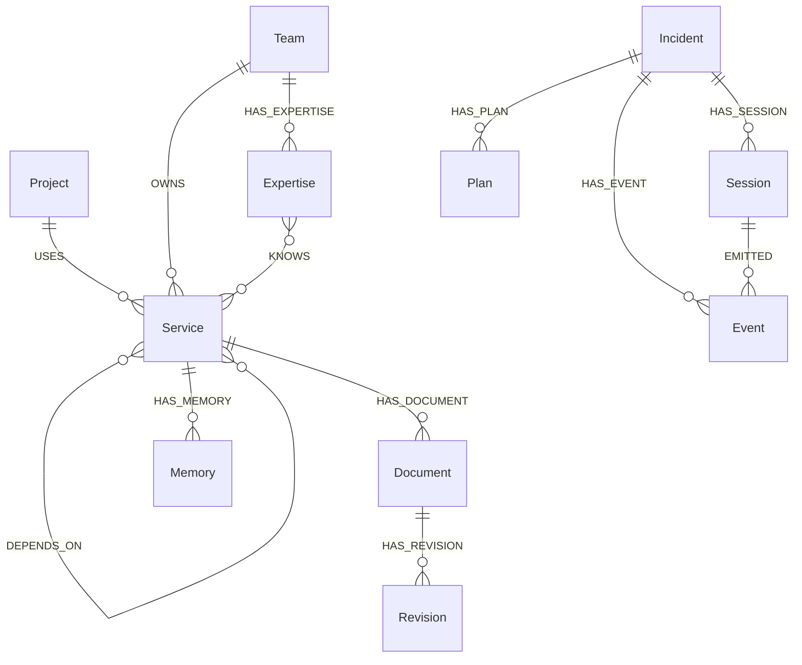

# FalkorDB schema and essential Cypher

Queries below are representative of the actual implementation in
`graphops/store.py`, `graphops/tools.py` and `graphops/worker.py`. Each server
selects a graph name derived from its trusted workspace configuration. Query
values are parameters; clients cannot submit arbitrary Cypher through the API.



## Trace dependency paths

```cypher
MATCH p=(:Service {id:$service})-[:DEPENDS_ON*1..8]->(:Service)
RETURN [n IN nodes(p)|n.id], [r IN relationships(p)|r.source]
ORDER BY length(p) LIMIT 50
```

This controls the set of eligible causes. Live HTTP evidence distinguishes own
faults from propagated failures. The traversal is bounded; this fixture does
not require PageRank, embeddings or an external graph analytics engine.

## Locate current ownership and sources

```cypher
MATCH (t:Team)-[r:OWNS]->(:Service {id:$id})
RETURN t.title,r.source
```

```cypher
MATCH (:Service {id:$id})-[:HAS_DOCUMENT]->(d:Document)
RETURN d.payload ORDER BY d.id
```

```cypher
MATCH (:Service {id:$id})-[:HAS_DOCUMENT]->(d:Document)-[:HAS_REVISION]->(v:Revision)
WHERE v.id <> d.id+':'+d.revision
RETURN v.payload LIMIT 12
```

Revision payloads are compared before writes; reusing an existing revision ID
with different content is rejected. This is an application invariant, not a
database schema constraint.

## Resume sessions with evidence

```cypher
MATCH (t:Incident {id:$id})-[:HAS_EVENT]->(e:Event)<-[:EMITTED]-(s:Session)
RETURN e.id,s.id,e.role,e.kind,e.time,e.payload
ORDER BY e.time LIMIT 500
```

```cypher
MATCH (:Incident {id:$task})-[:HAS_PLAN]->(p:Plan {id:$id})
RETURN p.payload
```

The second query binds a plan to its incident before execution.

## Claim a checkpoint version

```cypher
MATCH (t:Incident {id:$id}) WHERE t.version=$version
SET t.payload=$payload,t.version=t.version+1
```

The write helper returns an affected count in the same query. A zero count is
treated as a conflict requiring a reload. Context-changing writes also advance
the Meta revision used by the navigator cache.

## Retrieve shared memory

```cypher
MATCH (:Service {id:$id})-[:HAS_MEMORY]->(m:Memory)
RETURN m.payload ORDER BY m.time DESC LIMIT 20
```

The navigator bounds the packet further, checks source/configuration/age,
separates historical and unverified records, and lists conflicting active facts.
Recovery then validates live measurements independently of the cached packet.
